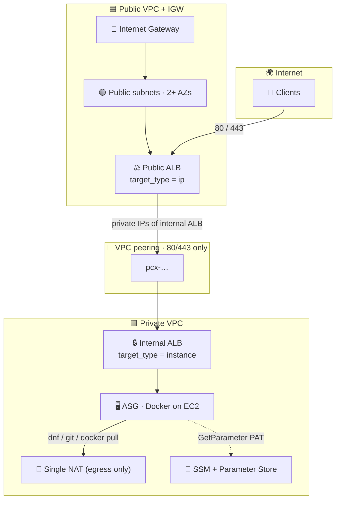
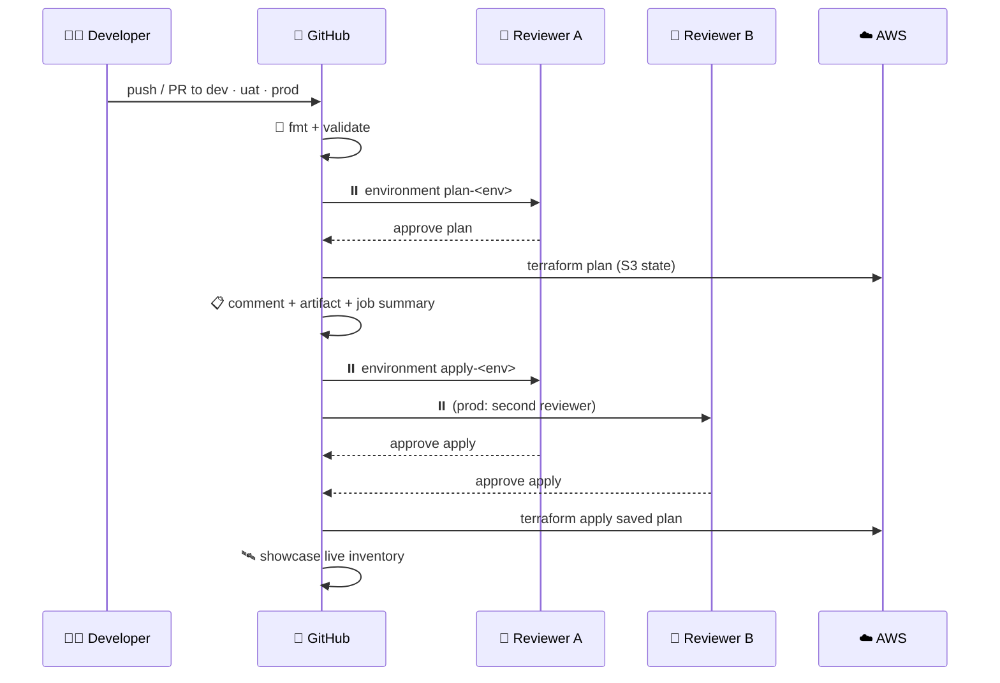

# 🌐 Dual-VPC Production Platform

<p align="center">
  
  
  
  
  
</p>

Production-style **template** that deploys a **public (edge) VPC** and a **private (workload) VPC**, stitches them with **VPC peering**, and fronts a two-instance web Auto Scaling Group with a **public ALB → internal ALB** path.

Every name, CIDR, instance type, tag and toggle is an **input** — this repo is meant to be copied, parameterised and reused.

---

## 🗺️ Architecture

```
                         🌍  Internet
                              │
                              │  TCP 80 / 443  (optional HTTPS + ACM)
                              ▼
                 ┌────────────────────────────┐
                 │  🟦  Public VPC            │
                 │  IGW · public subnets (×AZ)│
                 │                            │
                 │      ⚖️  Public ALB        │
                 │      (internet-facing)     │
                 └────────────┬───────────────┘
                              │
                              │  🔗 VPC peering
                              │  routes = peer CIDR only
                              │  SG / NACL = TCP 80 & 443 only
                              ▼
                 ┌────────────────────────────┐
                 │  🟪  Private VPC           │
                 │  workloads: no public IP   │
                 │  optional single NAT (egress)
                 │                            │
                 │      🔒  Internal ALB      │
                 │            │               │
                 │            ▼               │
                 │      🖥️  ASG (min 2)      │
                 │      Docker ← GitHub PAT   │
                 │      SSM (no SSH)          │
                 └────────────────────────────┘
```



### 🚦 Traffic path

| Hop | Component | Ports | Why |
| --- | --- | --- | --- |
| 1️⃣ | Client → **Public ALB** | `80` (`443` if ACM ARN is set) | Only internet-facing resource |
| 2️⃣ | Public ALB → **internal ALB ENI IPs** | `80` / `443` | AWS does not support ALB→ALB `target_type=alb` (that pairing is NLB→ALB). IP targets in a **peered VPC** are the supported pattern. |
| 3️⃣ | Internal ALB → **ASG instances** | application port (default `80`) | Instance target group + ELB health checks |
| 4️⃣ | Operators → instances | **SSM Session Manager** | Port `22` is never opened |
| 5️⃣ | Instance → **GitHub** | `443` via NAT | PAT from SSM; `git clone` + `docker build` |

### 🧱 Module map

| Module | Icon | Responsibility |
| --- | --- | --- |
| `modules/vpc-public` | 🟦🚪 | Public VPC, IGW, public subnets, public route table, optional NACL + flow logs |
| `modules/vpc-private` | 🟪🔒 | Private VPC, private subnets, optional single NAT + egress subnets, SSM endpoints |
| `modules/vpc-peering` | 🔗 | Same-account peering, DNS resolution, CIDR routes both ways |
| `modules/security-groups` | 🛡️ | Least-privilege SGs — `80/443` across the peer, ALB→instance on the app port |
| `modules/alb-public` | ⚖️ | Internet-facing ALB, IP target group, optional HTTP→HTTPS redirect |
| `modules/alb-internal` | 🔒⚖️ | Internal ALB, instance target group |
| `modules/asg-web` | 🖥️📈 | Launch template (IMDSv2, encrypted gp3), ASG, CPU target-tracking |
| `bootstrap/` | 🪣 | One-shot S3 bucket for remote state (TLS-only, versioned, encrypted) |

---

## ✨ Design choices (resilient · cheap · scalable)

### 🛡️ Resilience
- **2+ AZs** (ALB requirement) — public and private subnets in every chosen AZ.
- **ASG min = 2** with **ELB health checks** and **rolling instance refresh**.
- **Cross-zone load balancing** on both ALBs.
- **IMDSv2 required**, EBS **encrypted gp3**, ALB **invalid-header drop**.
- **Deletion protection** flag for production ALBs.
- CloudWatch alarms on **unhealthy host count** (console-visible, no SNS cost).

### 💸 Cost
- **NAT is off** until you set `github_repository` (demo mode needs no internet).
- **Single NAT Gateway** (one AZ) when container deploy is on — not one NAT per AZ.
- **No bastion / no public IPs** on workloads. The PAT is **not** in user-data.
- **SSM endpoints in a single AZ** by default (`ssm_endpoint_ha = false`).
- **gp3** baseline IOPS, **t3.micro / t3.small**, detailed monitoring **off**.
- Flow logs and ALB access logs **opt-in**.
- S3 native state locking (`use_lockfile`) — **no DynamoDB table**.

> ⚠️ VPC peering **cannot** carry `0.0.0.0/0` (no edge-to-edge / IGW / NAT through the peer). That is why the private VPC uses endpoints instead of “borrowed” NAT.

### 📈 Scale
- `asg_min_size` / `asg_desired_capacity` / `asg_max_size` are inputs.
- CPU **target-tracking** policy (default 60%).
- Extra AZs: raise `az_count` or pass `availability_zones`.

---

## 🎛️ Inputs (everything is user-supplied)

Copy `terraform.tfvars.example` or edit `environments/{dev,uat,prod}.tfvars`.

| Variable | What it controls | Default |
| --- | --- | --- |
| `project_name` | Name prefix on every resource | `dualvpc` |
| `environment` | `dev` \| `uat` \| `prod` | _(required)_ |
| `aws_region` | Region (both VPCs live here) | `us-east-1` |
| `owner` / `additional_tags` | Ownership + extra tags | `platform-team` / `{}` |
| `public_vpc_name` / `private_vpc_name` | VPC Name tags | auto `<project>-<env>-public\|private` |
| `public_vpc_cidr` / `private_vpc_cidr` | Must **not** overlap | `10.0.0.0/16` · `10.1.0.0/16` |
| `public_subnet_cidrs` / `private_subnet_cidrs` | Empty = auto `/24`s | `[]` |
| `availability_zones` / `az_count` | AZs (minimum 2) | first 2 in the region |
| `instance_type` | ASG instance class | `t3.micro` |
| `asg_min_size` / `desired` / `max` | Capacity | `2` / `2` / `4` |
| `allowed_ingress_cidrs` | Who can hit the public ALB | `0.0.0.0/0` |
| `public_alb_https_certificate_arn` | Empty = HTTP only | `""` |
| `enable_network_acls` | Extra subnet firewall | `true` |
| `enable_ssm_endpoints` / `ssm_endpoint_ha` | Session Manager path | `true` / `false` |
| `enable_deletion_protection` | Protect ALBs | `false` (prod tfvars: `true`) |
| `enable_flow_logs` / `enable_alb_access_logs` | Audit trails | `false` |
| `github_repository` | `owner/repo` to clone and run as a container | `""` (demo page) |
| `github_branch` | Branch or tag to check out | `main` |
| `github_pat_ssm_parameter_name` | SSM SecureString with the PAT | `""` |
| `dockerfile_directory` / `container_port` | Where the Dockerfile lives / container listen port | `.` / `80` |

---

## 🚀 Deploy from your laptop

Authentication uses the **standard AWS credential chain** — no OIDC, no assumed GitHub role:

1. `~/.aws/credentials` + `~/.aws/config`
2. `AWS_PROFILE=...`
3. `AWS_ACCESS_KEY_ID` / `AWS_SECRET_ACCESS_KEY` / optional `AWS_SESSION_TOKEN`

```bash
# 0. Tools
terraform version    # >= 1.10
aws sts get-caller-identity

# 1. One-time remote state bucket
make bootstrap AWS_REGION=us-east-1
# → paste the bucket name into backend-configs/*.hcl
# → also store it as GitHub secret TF_STATE_BUCKET

# 2. Init + plan + apply (example: dev)
export AWS_PROFILE=your-profile
make init    ENV=dev
make plan    ENV=dev
make apply   ENV=dev

# 3. See what is live
make showcase ENV=dev
```

Open the `public_alb_url` output in a browser. Demo mode shows the built-in status page. After you wire GitHub (next section) you will see your containerised app instead.

---

## 🐳 Deploy the application as a container from GitHub

Instances **do not** embed a Personal Access Token in user-data (that would leak via the EC2 console and instance metadata). The production pattern is:

```
GitHub PAT ──► SSM SecureString
                    │
                    │  instance IAM (ssm:GetParameter only)
                    ▼
              /usr/local/bin/deploy-app.sh
                    │
                    ├─ git clone  (http.extraheader — token never stored in remotes)
                    ├─ docker build
                    └─ docker run -p <web_listen_port>:<container_port>
```

A single **NAT Gateway** is created automatically in the private VPC so `dnf`, `git clone github.com`, and `docker pull` can reach the internet. Workloads stay in private subnets with **no public IP**.

### 1️⃣ Create a fine-grained GitHub PAT

GitHub → **Settings → Developer settings → Fine-grained tokens**

| Scope | Why |
| --- | --- |
| **Contents: Read** on the one application repo | `git clone` |
| **Packages: Read** (only if the Dockerfile pulls from GHCR) | `docker pull ghcr.io/...` |

Classic PATs work too (`repo` for private, public repos need no extra scope if the repo is public — still send a PAT so rate limits stay sane).

### 2️⃣ Store the PAT in SSM (preferred — token never enters Terraform state)

```bash
export AWS_PROFILE=your-profile
export AWS_REGION=us-east-1
export GITHUB_PAT=github_pat_xxxxx          # do not pass this as a CLI argument
./scripts/store-github-pat.sh /dualvpc/dev/github-pat
```

### 3️⃣ Point Terraform at the repo

Uncomment and edit `environments/dev.tfvars` (same keys exist for uat / prod):

```hcl
github_repository             = "your-org/your-app"
github_branch                 = "main"
github_pat_ssm_parameter_name = "/dualvpc/dev/github-pat"
dockerfile_directory          = "."   # folder that contains the Dockerfile
container_port                = 80    # port the process listens on inside the container
instance_type                 = "t3.small"   # docker build is tight on t3.micro
root_volume_size_gb           = 20
```

The application repo **must** contain a `Dockerfile`. A working sample you can push as a first repo lives in [`examples/sample-webapp/`](examples/sample-webapp/). Prefer base images from `public.ecr.aws` to avoid Docker Hub rate limits.

### 4️⃣ Apply and watch

```bash
make plan  ENV=dev
make apply ENV=dev
make showcase ENV=dev
```

First boot takes several minutes (dnf + clone + build). The ASG health-check grace period is raised to **600s** in this mode. User-data logs: `/var/log/user-data.log`.

### 🔄 Redeploy a new commit (no instance replace)

```bash
aws ssm start-session --target i-xxxxxxxx --region us-east-1
sudo /usr/local/bin/deploy-app.sh
```

The script pulls the PAT again, `git fetch`es `github_branch`, rebuilds, and replaces the container. To roll every instance, change a tag or the launch template and let **instance refresh** recycle the ASG.

### 🔐 Last-resort: pass the PAT to Terraform

Only if you cannot pre-create the SSM parameter:

```hcl
github_pat = "github_pat_xxxxx"   # sensitive — still written to Terraform state
```

Terraform then creates `/<project>/<env>/github-pat`. Prefer `github_pat_ssm_parameter_name`.

### 🔐 Day-2 access (no SSH)

```bash
aws ssm start-session --target i-xxxxxxxx --region us-east-1
```

Requires `enable_ssm_endpoints = true` (default) and the instance profile attached by the ASG module.

### 💣 Tear down

```bash
# Prod ALBs have deletion protection in environments/prod.tfvars —
# flip it off first, or use the GitHub destroy action.
make destroy ENV=dev
```

---

## 🐙 GitHub Actions workflow

The workflow [`.github/workflows/terraform.yml`](.github/workflows/terraform.yml) deploys **from the branch name**.

| Branch | tfvars | Plan | Apply |
| --- | --- | --- | --- |
| `dev` (or `develop`) | `environments/dev.tfvars` | ✅ after **plan-dev** approval | ✅ after **apply-dev** approval |
| `uat` (or `staging`) | `environments/uat.tfvars` | ✅ after **plan-uat** approval | ✅ after **apply-uat** approval |
| `prod` (or `main`) | `environments/prod.tfvars` | ✅ after **plan-prod** approval | ✅ after **apply-prod** approval |
| Pull request → those branches | matching **base** branch | ✅ after plan approval | ❌ never |



### 🔑 Secrets & variables (copied from the laptop)

| Name | Where | Purpose |
| --- | --- | --- |
| `AWS_ACCESS_KEY_ID` | Repository **Secret** | Same access key as `aws configure` on the laptop |
| `AWS_SECRET_ACCESS_KEY` | Repository **Secret** | Matching secret key |
| `AWS_SESSION_TOKEN` | Repository **Secret** (optional) | Required only if the laptop uses STS/SSO temporary creds |
| `TF_STATE_BUCKET` | Repository **Secret** | Bucket created by `make bootstrap` |
| `AWS_REGION` | Repository **Variable** | Default `us-east-1` |

> 🔒 Prefer a dedicated IAM user with least-privilege Terraform permissions, not a long-lived root key. Rotate the keys you paste into GitHub the same way you rotate laptop keys.

### 🗳️ Create the six Environments (required reviewers)

GitHub → **Settings → Environments** → create each name below and add **Required reviewers**.

| Environment | Suggested reviewers | Used by |
| --- | --- | --- |
| `plan-dev` | 1 | Plan job (dev) |
| `apply-dev` | 1 | Apply job (dev) |
| `plan-uat` | 1–2 | Plan job (uat) |
| `apply-uat` | 2 | Apply job (uat) |
| `plan-prod` | 2 | Plan job (prod) |
| `apply-prod` | **2+** | Apply **and** destroy (prod) |

Until these exist, GitHub will auto-create them **without** reviewers on first run — add the reviewers **before** the first production push.

Optional: uncomment `.github/CODEOWNERS` so every Terraform change also needs a pull-request review.

### 🎛️ Manual runs

**Actions → 🏗️ Terraform → Run workflow**

| `action` | What happens |
| --- | --- |
| `plan` | Approval → plan → summary / PR comment |
| `apply` | Approval → plan → approval → apply → showcase |
| `showcase` | Reads current state and publishes the live inventory |
| `destroy` | Approval on `apply-<env>` → destroy (prod protection is cleared first) |

### 🛰️ What “showcase” prints

The job summary (and `make showcase` on the laptop) includes:

- 🌍 account / region
- 🌐 public ALB URL + HTTP health
- 🟦🟪 VPC IDs, 🚪 IGW, 🔗 peering
- 🖥️ ASG name, instance type, in-service / min / desired / max

---

## 📁 Repository layout

```
.
├── main.tf / variables.tf / outputs.tf / locals.tf
├── backend.tf                      # S3 + native lockfile
├── environments/{dev,uat,prod}.tfvars
├── backend-configs/{dev,uat,prod}.hcl
├── modules/
│   ├── vpc-public/  vpc-private/  vpc-peering/
│   ├── security-groups/
│   ├── alb-public/  alb-internal/
│   └── asg-web/
├── templates/user_data.sh.tftpl    # Docker-from-GitHub + demo fallback
├── templates/deploy-app.sh         # idempotent clone / build / run (re-runnable via SSM)
├── examples/sample-webapp/         # reference Dockerfile you can push to GitHub
├── bootstrap/                      # state bucket
├── scripts/showcase.sh
├── scripts/store-github-pat.sh     # PAT → SSM SecureString
└── .github/workflows/terraform.yml
```

---

## ✅ Pre-flight checklist

- [ ] AWS credentials work on the laptop (`aws sts get-caller-identity`)
- [ ] `make bootstrap` has been applied and the bucket name is in `backend-configs/*.hcl`
- [ ] CIDRs in the tfvars **do not overlap** and are unused in the account
- [ ] At least **two** AZs in the chosen region
- [ ] GitHub secrets `AWS_ACCESS_KEY_ID`, `AWS_SECRET_ACCESS_KEY`, `TF_STATE_BUCKET` set
- [ ] Environments `plan-*` and `apply-*` exist with required reviewers
- [ ] Branches `dev`, `uat`, `prod` exist (create an empty `dev` to start)
- [ ] (Container deploy) PAT stored in SSM and `github_repository` set in tfvars
- [ ] (Container deploy) Application repo has a `Dockerfile` at `dockerfile_directory`

---

## 🩺 Troubleshooting

| Symptom | Likely cause | Fix |
| --- | --- | --- |
| Public ALB targets stay **unhealthy** | Internal ALB ENIs not yet registered, or SG/NACL blocked | Wait for ASG `InService`; confirm peering routes; `80/443` only |
| `Invalid index` on `network_interfaces.ids` | Internal ALB ENIs not ready in 45s | Re-run `terraform apply` (data source will refresh) |
| SSM `TargetNotConnected` | Endpoints disabled, or agent has no path to `ssm` | Set `enable_ssm_endpoints = true`; check endpoint SG |
| `AccessDenied` on state | Wrong bucket / key / region | `make bootstrap` output vs `TF_STATE_BUCKET` |
| Plan waits forever | Environment has required reviewers | A second GitHub user must **Approve** the pending job |
| HTTPS listener missing | `public_alb_https_certificate_arn` is empty | Pass an ACM cert ARN in the same region |
| Container never starts | No NAT, bad PAT, or missing Dockerfile | `/var/log/user-data.log`; `sudo journalctl -u webapp`; confirm SSM parameter and `contents:read` |
| `AccessDeniedException` on GetParameter | Instance role cannot read the parameter | Parameter name/ARN mismatch; parameter must exist **before** instances boot |
| `git clone` 401 / 404 | PAT scope or repo name | Fine-grained token needs **Contents: Read** on that repo; `owner/repo` spelling |
| Docker Hub `toomanyrequests` | Anonymous pull limit | Use `public.ecr.aws/...` base images (see `examples/sample-webapp`) |

---

## 💵 Rough monthly cost (us-east-1, 2 AZ, defaults)

| Item | Demo (no GitHub) | Container deploy |
| --- | --- | --- |
| 2 × ALB | ~ $32 | ~ $32 |
| 2 × EC2 | ~ $15 (t3.micro) | ~ $30 (t3.small) |
| 3 × SSM endpoints (1 AZ) | ~ $22 | ~ $22 |
| Single NAT + EIP | **$0** | ~ $32 + data |
| **Ballpark** | **~$70** | **~$115** |

Leave `github_repository` empty to keep NAT off. Turn off endpoints (`enable_ssm_endpoints = false`) only if you do not need Session Manager.

---

<p align="center">
  <sub>Built as a reusable Terraform template · parameterise · peer · scale</sub>
</p>
